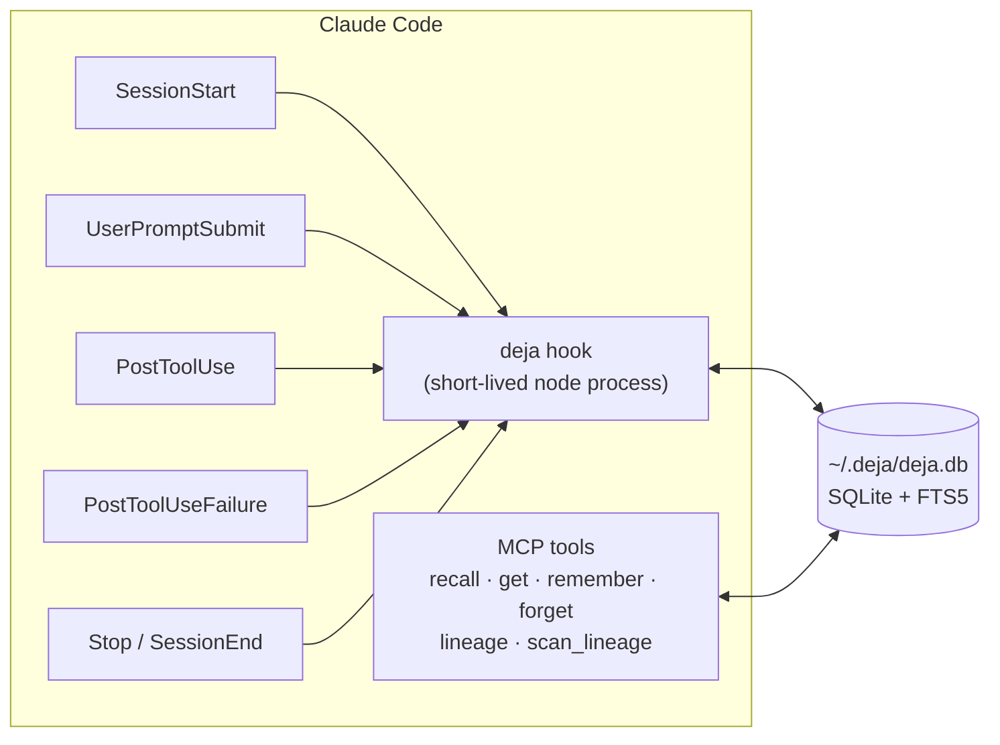

<p align="center">
  
</p>

<h1 align="center">deja</h1>

<p align="center">
  <b>Memory for Claude Code that never debugs the same bug twice.</b><br>
  Zero dependencies. No daemon. No extra tokens.
</p>

<p align="center">
  <a href="https://github.com/sagarkonkanagaon-netizenk/deja/actions/workflows/ci.yml"></a>
  
  
  
</p>

<p align="center">
  
</p>

Claude Code forgets everything when a session ends. So every week you watch it rediscover the same missing env var, the same schema drift, the same flaky import, and pay for the same tokens to fix it again.

deja gives it a memory that works the way you would want a senior teammate's to:

- **It remembers fixes, not just transcripts.** When a command fails and later passes, deja records the error and exactly what changed in between. The next time that error shows up, in any session or any repo, the fix is placed right next to the failure, before Claude starts guessing.
- **It knows when a memory is out of date.** Every memory is pinned to the content hash of the files it talks about. Change the file and the memory is flagged as possibly stale, instead of confidently steering Claude wrong.
- **It maps your data.** deja reads the SQL, dbt, PySpark, Delta Live Tables, notebook and Airflow files Claude touches and builds a lineage graph, so "what breaks if I change `silver.orders`?" is one tool call.
- **It costs nothing to run.** No background worker, no port, no vector database, no Python, no LLM calls of its own. Hooks are short-lived Node processes writing to one SQLite file with full-text search built in.

## Install

Requires Claude Code and Node.js 22.13 or newer on your `PATH` (check with `node -v`).

```text
/plugin marketplace add sagarkonkanagaon-netizenk/deja
/plugin install deja@deja
```

Restart Claude Code. That's it: there is nothing to start, configure or keep running. Run `/deja:stats` in a session to check that it is recording.

## What a session looks like

**Session start.** Claude gets a compact briefing (about 1,500 tokens at most, you can change that): the last session's summary, decisions and gotchas, open todos, learned fixes, and anything that went stale.

```text
deja memory for orders-pipeline: 37 memories.

Last session:
- add late-arriving data handling to silver_orders (2d ago)
  Changed: jobs/silver_orders.py, tests/test_silver.py. Fixed: #41 Failed to merge fields 'amount'...

Decisions and gotchas:
- #12 [decision] Backfills use replaceWhere on dt → full overwrite drops late partitions (3w ago)
- #19 [gotcha] Staging warehouse lowercases column names → compare case-insensitively (1w ago)

Possibly outdated (anchored files changed since these were written):
- #8 [decision, stale] Retries are 3 because the vendor API rate-limits at 4 (2mo ago)

Data lineage: 64 datasets and 5 Airflow DAGs mapped.
```

**While working.** Opening a file brings back what is known about that file. A prompt that matches past decisions brings those in. Each memory is shown at most once per session.

**When something fails.** If deja has seen that error before (normalized, so different paths, line numbers, ids and timestamps still match), the fix is injected next to the error:

```text
deja has seen this error before:
- #41 22d ago: edited jobs/silver_orders.py; then `spark-submit jobs/silver_orders.py` passed.
  Cause: source sends amount as double — cast to decimal(12,2) before MERGE
```

**When it passes.** deja saves the error, the files edited and the commands run in between, and the command that finally passed. If Claude knows the root cause, it adds it with `remember` and the cause travels with the fix.

## How it works



| Event | What deja does |
| --- | --- |
| `SessionStart` | Re-checks file hashes, then injects a ranked briefing within the token budget |
| `UserPromptSubmit` | Full-text search over memories; injects up to 3 strong matches not already shown |
| `PostToolUse` | Logs edits and commands, updates lineage for data files, surfaces memories about the file just opened, and turns a pending failure into a fix memory when its command family passes |
| `PostToolUseFailure` | Normalizes the error into a signature, looks up fixes (this repo first, then all repos), records the failure |
| `Stop`, `SessionEnd` | Writes a deterministic session summary: what was asked, what changed, what was fixed, how it ended |

Ranking is BM25 from SQLite FTS5, weighted by kind (fixes and gotchas first), recency, how often a memory was useful, and staleness.

A few details that keep it accurate:
- **Error signatures** keep the meaningful lines of an error (the last exception in a Python or JVM trace, the `Error:` line in Node) and strip paths, line numbers, hex ids, UUIDs, timestamps and ports.
- **Command families** decide what counts as "the same command passing": `npm test -- --ci` resolves `npm test`; `pytest tests/b.py -k x` resolves `pytest tests/a.py`.
- **Noise is ignored.** `grep` finding nothing or `diff` finding a difference is not a bug. A retry that passes with nothing changed in between is treated as flaky and teaches nothing.

## MCP tools

| Tool | Use it for |
| --- | --- |
| `recall` | Search memory; returns a compact index (id, kind, title, age, stale flag). `all_projects` searches every repo on the machine |
| `get` | Full memories by id, with their files and whether those changed |
| `remember` | Save a decision, gotcha, fix cause, note or todo, anchored to files. Same title updates in place |
| `forget` | Delete memories that are wrong |
| `lineage` | Upstream and downstream for a table, path or `dag:<id>`, with the file responsible and known columns |
| `scan_lineage` | Index every SQL, dbt, PySpark, notebook and Airflow file in the repo once |

Slash commands: `/deja:recall`, `/deja:remember`, `/deja:lineage`, `/deja:stats`. A bundled skill tells Claude when saving a memory is worth it, and when it is not.

## Data lineage

deja is built by a data engineer, so data repos get extra attention. On every read or edit of a data file, and on demand with `scan_lineage`, it extracts:

| Source | What it finds |
| --- | --- |
| SQL / HiveQL | `INSERT INTO/OVERWRITE`, `MERGE INTO … USING`, `CREATE TABLE/VIEW … AS`, `COPY INTO`, `UPDATE`, `DELETE`; `FROM` and `JOIN` inputs with CTEs excluded; column lists from DDL |
| dbt | The model (from the file name), `ref()` and `source()` inputs, Jinja stripped |
| PySpark | `spark.table`, `read.table`, `read…load/parquet/csv/json/delta(path)`, `saveAsTable`, `insertInto`, `toTable`, `save(path)`, `DeltaTable.forName`, and SQL inside `spark.sql(...)` |
| Delta Live Tables | `@dlt.table` / `@dlt.view` targets and `dlt.read` / `dlt.read_stream` inputs |
| Airflow | DAG id, task ids, `>>` / `<<` dependencies, and lineage from `sql=` arguments |
| Notebooks | All of the above, from `.ipynb` code cells |

```text
$ deja lineage gold.revenue
gold.revenue is written by jobs/silver_to_gold.sql

upstream:
← silver.orders (jobs/silver_to_gold.sql)
  ← bronze.orders (jobs/bronze_to_silver.sql)
← silver.fx (jobs/silver_to_gold.sql)

downstream:
→ bi.revenue_dashboard (jobs/report.py)
```

Lineage is file-level and regex-based on purpose: it has to run inside a hook in milliseconds and never fail. It does not resolve dynamic table names built at runtime.

## How deja compares

claude-mem is the most popular memory plugin and a great project; it pioneered a lot of this. deja makes different trade-offs. This table reflects claude-mem's own docs as of October 2026:

| | deja | claude-mem |
| --- | --- | --- |
| Runtime dependencies | Node.js ≥ 22.13 only | Bun, Node.js, optional Python + Chroma |
| Background process | None | Worker service on port 37777 |
| Extra LLM calls | None | Uses Claude to compress observations |
| Error → fix recall at the moment of failure | Yes | Not documented |
| Stale-memory detection (file hashes) | Yes | Not documented |
| Data lineage (SQL, dbt, Spark, Airflow) | Yes | Not documented |
| Web viewer UI | Not yet | Yes |
| Semantic (embedding) search | No, FTS5 keyword search | Yes, with Chroma |
| Works with Gemini CLI, OpenCode, Codex | Not yet | Yes |

If you want semantic search and a web UI today, use claude-mem. If you want something that cannot break your session, costs nothing and learns from your failures, use deja.

## Performance

Measured with `npm run bench` (Node 22, Linux, 5,000 memories, wall time of a fresh process per hook, the way Claude Code runs it):

| Hook | p50 | p95 |
| --- | --- | --- |
| bare `node -e 0` (for reference) | 34 ms | 51 ms |
| SessionStart | 77 ms | 109 ms |
| UserPromptSubmit | 79 ms | 115 ms |
| PostToolUse (edit of a .sql file) | 66 ms | 92 ms |
| PostToolUse (Bash) | 62 ms | 84 ms |
| PostToolUseFailure | 68 ms | 101 ms |

About two-thirds of each number is Node starting up. Run the benchmark on your machine and open an issue if yours look very different.

## Privacy

- Everything stays in `~/.deja/deja.db` on your machine. deja makes no network calls.
- Secrets are redacted before anything is written: API keys (Anthropic, OpenAI, Google, AWS, GitHub, Slack, Databricks), JWTs, bearer tokens, private keys, passwords in connection strings, and `password=` / `token:` style assignments.
- Wrap anything in `<private>…</private>` in a prompt and it is never stored.
- Put an empty `.deja-off` file in a repo to turn deja off there, or set `DEJA_DISABLE=1`.

## CLI

The plugin uses the same entry point, and you can run it yourself (`node ~/.claude/plugins/.../bin/deja.mjs`, or clone this repo and `npm link`):

```text
deja recall [query]          deja lineage <table> [--up|--down]
deja get <id...>             deja scan [dir]
deja remember <title> --body "..." --kind decision --files a.py
deja forget <id...>          deja stats [--all]
deja export [--json] [--out FILE]
deja import <file.json>      deja doctor
```

`deja export > MEMORY.md` writes a readable Markdown file you can commit, so the team (and new contributors) get the same knowledge. `deja export --json` and `deja import` move memories between machines.

## Configuration

| Variable | Default | Meaning |
| --- | --- | --- |
| `DEJA_HOME` | `~/.deja` | Where the database and logs live |
| `DEJA_CONTEXT_TOKENS` | `1500` | Budget for the session-start briefing |
| `DEJA_DISABLE` | unset | `1` turns every hook into a no-op |
| `DEJA_TIMING` | unset | `1` logs each hook's duration to `~/.deja/timing.log` |

Hooks never block or break a session. On any error they exit cleanly and log to `~/.deja/deja.log`.

## Roadmap

- [ ] `deja ui`: a static, single-file HTML viewer for memories and the lineage graph
- [ ] Optional local embeddings for semantic recall, still with zero required dependencies
- [ ] Column-level lineage for SQL
- [ ] Adapters for Codex, Gemini CLI and OpenCode
- [ ] Team memory: sync the exported Markdown back in on `git pull`

Ideas and pull requests are welcome; see [CONTRIBUTING.md](CONTRIBUTING.md).

## License

MIT
