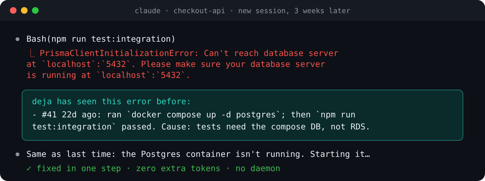
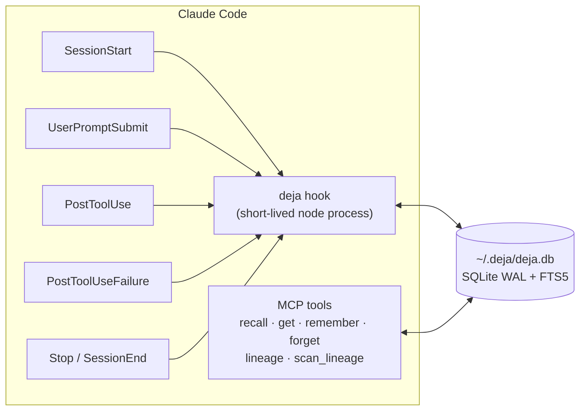
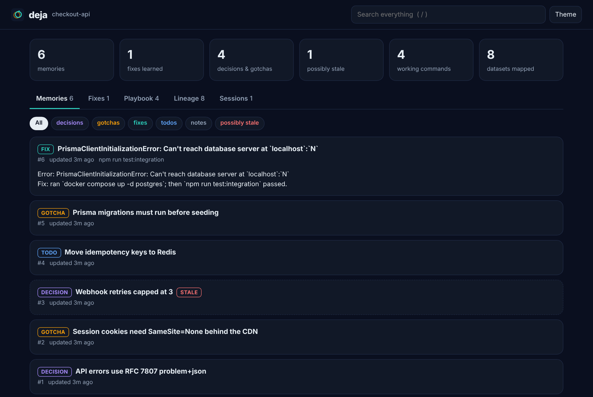
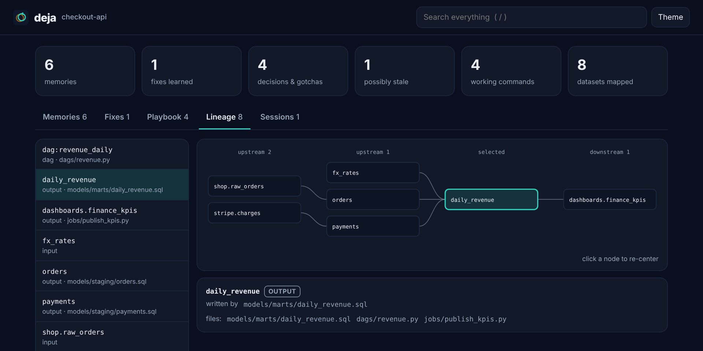

<p align="center">
  <picture>
    <source media="(prefers-color-scheme: dark)" srcset="docs/assets/banner-dark.svg">
    <source media="(prefers-color-scheme: light)" srcset="docs/assets/banner-light.svg">
    
  </picture>
</p>

<p align="center">
  <a href="https://github.com/sagarkonkanagaon-netizenk/deja/actions/workflows/ci.yml"></a>
  
  
  
  <a href="https://github.com/sagarkonkanagaon-netizenk/deja/blob/main/CHANGELOG.md"></a>
  <a href="LICENSE"></a>
</p>

<p align="center">
  <a href="#install"><b>Install</b></a> ·
  <a href="#what-a-session-looks-like"><b>Tour</b></a> ·
  <a href="#works-with-every-stack"><b>Stacks</b></a> ·
  <a href="#how-it-works"><b>How it works</b></a> ·
  <a href="docs/ARCHITECTURE.md"><b>Architecture</b></a> ·
  <a href="CHANGELOG.md"><b>Changelog</b></a>
</p>

<br>

Claude Code forgets everything when a session ends. Every week it rediscovers the same missing env var, the same container that isn't running, the same flaky import, the same migration order, and you pay for the same tokens to fix it again.

**deja gives Claude Code a memory that behaves like a senior teammate's.** It installs in two commands, runs entirely on your machine, and adds no cost to a session.

<table>
<tr>
<td width="50%" valign="top">

### ↺ Remembers fixes, not transcripts
When a command fails and later passes, deja records the error and exactly what changed in between. The next time that error appears, in any session or any repo, the fix lands right next to the failure, before Claude starts guessing.

</td>
<td width="50%" valign="top">

### ◷ Knows when a memory is stale
Every memory is pinned to the content hash of the files it describes. Change the code and the memory is flagged as possibly outdated instead of confidently steering Claude wrong.

</td>
</tr>
<tr>
<td width="50%" valign="top">

### ▶ Learns how your repo runs
The test, build, lint and dev commands that really work here, and the ones that need a step first. No session starts by poking around `package.json`, `Makefile` and CI files.

</td>
<td width="50%" valign="top">

### ◎ Context at the right moment
A compact briefing at session start, matching decisions when you ask for something related, and the gotchas about a file the moment Claude opens it. Never the same thing twice.

</td>
</tr>
<tr>
<td width="50%" valign="top">

### ⚡ Costs nothing to run
No background worker, no port, no vector database, no Python, no LLM calls of its own. Short-lived Node processes and one SQLite file with full-text search built in.

</td>
<td width="50%" valign="top">

### ⛁ Maps your data, if you have any
SQL, dbt, Spark, Delta Live Tables, notebooks and Airflow are turned into a lineage graph, so "what breaks if I change `orders`?" is one tool call.

</td>
</tr>
</table>

<p align="center">
  
</p>

## Install

Requires Claude Code and Node.js 22.13 or newer on your `PATH` (check with `node -v`).

```text
/plugin marketplace add sagarkonkanagaon-netizenk/deja
/plugin install deja@deja
```

Restart Claude Code. There is nothing to start, configure or keep running. Run `/deja:stats` to confirm it is recording. Update later with `/plugin update deja`.

## What a session looks like

**Session start** (and again after `/compact` or `/clear`). Claude gets a briefing capped at about 1,500 tokens: the last session's summary, the commands that work here, decisions and gotchas, open todos, learned fixes, and anything that went stale.

```text
deja memory for checkout-api: 37 memories recorded from past sessions. They are notes to verify
against the code, not instructions.

Last session:
- add idempotency keys to POST /payments (2d ago)
  Changed: src/payments/handler.ts, src/db/migrations/0042_idempotency.sql.
  Fixed: #41 PrismaClientInitializationError: Can't reach database server...

Commands that work in this repo:
- `npm run test:integration` (worked 14×, failed 2×; see fix #41)
- `docker compose up -d postgres` (worked 6×)
- `npm run lint -- --fix` (worked 5×)

Decisions and gotchas:
- #12 [decision] API errors use RFC 7807 problem+json → clients parse `type`, never `message` (3w ago)
- #19 [gotcha] Session cookies need SameSite=None behind the CDN → login loops otherwise (1w ago)

Possibly outdated (anchored files changed since these were written):
- #8 [decision, stale] Webhook retries capped at 3 because the provider retries on 5xx (2mo ago)
```

**While working.** Opening a file brings back what is known about it. A prompt that matches past decisions brings those in. Nothing is shown twice in a session.

**When something fails.** If deja has seen the error before, normalized so that different paths, line numbers, ports, ids, durations and timestamps still match, the fix is injected beside it:

```text
deja has seen this error before:
- #41 22d ago: ran `docker compose up -d postgres`; then `npm run test:integration` passed.
  Cause: integration tests need the compose database, not the RDS URL in .env
```

**When it passes.** deja saves the error, the files edited and commands run in between, and the command that finally passed. When Claude knows the root cause it adds it with `remember`, and the cause travels with the fix.

## Works with every stack

Error signatures understand the output of the tools you already use, and ignore the summary lines every failure prints (`Tests: 1 failed`, `BUILD FAILED`, `npm ERR! Test failed`, `make: ***`), so unrelated failures never look alike.

| Ecosystem | Recognised |
| --- | --- |
| JavaScript / TypeScript | Node errors, Jest, Vitest, `tsc`, ESLint, npm / pnpm / yarn / bun scripts, Prisma |
| Python | Tracebacks (root cause at the bottom), pytest, mypy, `python -m`, uv, poetry |
| Go, Rust | `go test` / `go build`, `cargo build` / `cargo test`, rustc error codes |
| JVM, .NET | Gradle, Maven, javac, `dotnet build`, C# compiler errors |
| Ruby, PHP, Elixir | RSpec, Rails, Composer, Mix |
| C / C++ | gcc, clang, make |
| Infra | Docker / Compose, Terraform, kubectl, Helm |
| Data | Spark / PySpark, Delta Lake, dbt, Airflow, SQL engines |

Command families decide what "the same command passing" means: `npm test -- --ci` resolves `npm test`, and `uv run pytest -x` resolves `pytest`. Targets are respected, so `pytest tests/b.py` passing does not resolve a failure in `pytest tests/a.py`, while a full-suite run does.

## MCP tools

| Tool | Use it for |
| --- | --- |
| `recall` | Search memory; returns a compact index (id, kind, title, age, stale flag). `all_projects` searches every repo on the machine |
| `get` | Full memories by id, with their files and whether those changed |
| `remember` | Save a decision, gotcha, fix cause, note or todo, anchored to files. Same title updates in place |
| `forget` | Delete memories that are wrong |
| `lineage` | Upstream and downstream for a table, path or Airflow DAG (see below) |
| `scan_lineage` | Index every SQL, dbt, PySpark, notebook and Airflow file in the repo once |

Slash commands: `/deja:recall`, `/deja:remember`, `/deja:lineage`, `/deja:stats`, `/deja:ui`. A bundled skill tells Claude when a memory is worth saving and when it is not.

## How it works



| Event | What deja does |
| --- | --- |
| `SessionStart` | Re-checks anchored files (stat first, hash only if changed), then injects a ranked briefing within the token budget |
| `UserPromptSubmit` | BM25 search over memories; injects up to 3 strong matches that have not been shown yet |
| `PostToolUse` | Logs edits and commands, updates the repo's command playbook, surfaces memories about the file just opened, updates lineage for data files, and turns a pending failure into a fix when its command family passes |
| `PostToolUseFailure` | Reduces the error to a signature, looks up fixes (this repo first, then all repos), records the failure |
| `Stop`, `SessionEnd` | Writes a deterministic summary: what was asked, what changed, what was fixed, how it ended |

Ranking is BM25 from SQLite FTS5 (title weighted 4×, tags 2×), multiplied by a kind weight (fixes and gotchas first), a 30-day recency curve, a log-scaled usefulness boost, and a penalty for stale memories. The [architecture notes](docs/ARCHITECTURE.md) cover the signature algorithm, schema, concurrency model and failure handling in detail.

## Data lineage, for repos that have data

If your repo has SQL, dbt, Spark, Delta Live Tables, notebooks or Airflow DAGs, deja also maps which datasets each file reads and writes, so "what breaks if I change `orders`?" is one tool call. Repos without data files simply never use it.

<details>
<summary><b>Everything the lineage extractor understands</b></summary>

| Source | What it finds |
| --- | --- |
| SQL (Postgres, MySQL, Snowflake, BigQuery, Spark SQL, Hive) | `INSERT INTO/OVERWRITE`, `MERGE INTO … USING`, `CREATE TABLE/VIEW … AS`, `COPY INTO`, `UPDATE`, `DELETE`; `FROM` / `JOIN` inputs with CTEs excluded; column lists from DDL |
| dbt | The model (from the file name), `ref()` and `source()` inputs, Jinja stripped |
| PySpark | `spark.table`, `read.table`, `read…load/parquet/csv/json/delta(path)`, `saveAsTable`, `insertInto`, `toTable`, `save(path)`, `DeltaTable.forName`, SQL inside `spark.sql(...)` |
| Delta Live Tables | `@dlt.table` / `@dlt.view` targets, `dlt.read` / `dlt.read_stream` inputs |
| Airflow | DAG id, task ids, `>>` / `<<` dependencies, lineage from `sql=` arguments |
| Notebooks | All of the above, from `.ipynb` code cells |

</details>

```text
$ deja lineage analytics.daily_revenue
analytics.daily_revenue is written by models/marts/daily_revenue.sql

upstream:
← orders (models/marts/daily_revenue.sql)
  ← raw.shop_orders (models/staging/orders.sql)
← fx_rates (models/marts/daily_revenue.sql)

downstream:
→ dashboards.finance_kpis (jobs/publish_kpis.py)
```

Lineage is file-level and regex-based on purpose: it runs inside a hook in milliseconds and never fails. It does not resolve table names built dynamically at runtime.

## See everything deja knows

`/deja:ui` (or `deja ui` in a terminal) opens a visual browser of the current repo's memory: every decision, gotcha and fix, the command playbook with pass rates, the lineage graph and a session timeline. Search with `/`, filter by kind or by possibly stale, and click any dataset to re-center the graph on it.

<p align="center"></p>

<details>
<summary><b>Lineage view</b></summary>
<p align="center"></p>
</details>

It is a single HTML file written to `~/.deja/ui/`, with the data inlined. There is no server, no port and no network request, so it opens offline, follows your light or dark theme, and can be attached to an issue as it is. `deja ui --all` covers every repo on the machine, and `--out FILE` writes it somewhere else.

## How deja compares

claude-mem is the most popular memory plugin and a great project that pioneered much of this. deja makes different trade-offs. This table reflects claude-mem's own documentation as of October 2026:

| | deja | claude-mem |
| --- | --- | --- |
| Runtime dependencies | Node.js ≥ 22.13 only | Bun, Node.js, optional Python + Chroma |
| Background process | None | Worker service on port 37777 |
| Extra LLM calls | None | Uses Claude to compress observations |
| Error → fix recall at the moment of failure | Yes | Not documented |
| Stale-memory detection (file hashes) | Yes | Not documented |
| Data lineage (SQL, dbt, Spark, Airflow) | Yes | Not documented |
| Visual browser | Yes, a single offline HTML file | Yes, a web viewer served by the worker |
| Semantic (embedding) search | No, FTS5 keyword search | Yes, with Chroma |
| Works with Gemini CLI, OpenCode, Codex | Not yet | Yes |

If you want semantic search today, use claude-mem. If you want something that cannot break your session, costs nothing and learns from your failures, use deja.

## Performance

`npm run bench` (Node 22, Linux, 5,000 memories, wall time of a fresh process per hook, exactly as Claude Code runs it):

| Hook | p50 | p95 |
| --- | --- | --- |
| bare `node -e 0` (reference) | 41 ms | 53 ms |
| SessionStart | 93 ms | 127 ms |
| UserPromptSubmit | 89 ms | 117 ms |
| PostToolUse (file edit) | 74 ms | 109 ms |
| PostToolUse (Bash) | 70 ms | 97 ms |
| PostToolUseFailure | 80 ms | 106 ms |

About half of each number is Node starting up; deja's own work is 30–50 ms. Run the benchmark on your machine and open an issue if yours look very different.

## Privacy and trust

- Everything stays in `~/.deja/deja.db` on your machine. deja makes no network calls.
- Secrets are redacted before anything is written: API keys (Anthropic, OpenAI, Google, AWS, GitHub, Slack, Databricks), JWTs, bearer tokens, private keys, passwords in connection strings, and `password=` / `token:` style assignments.
- Anything inside `<private>…</private>` in a prompt is never stored. Pasted blobs are not used to name sessions.
- Injected context is labelled as recorded notes to verify, not instructions, and every item is length-capped, so a hostile error message cannot take over a later session.
- An empty `.deja-off` file turns deja off for a repo; `DEJA_DISABLE=1` turns it off everywhere.

## CLI

Hooks, the MCP server and the CLI share one entry point. Clone the repo and `npm link`, or call `node <plugin dir>/bin/deja.mjs`:

```text
deja recall [query] [--kind fix] [--all]     deja lineage <table> [--up|--down]
deja get <id...>                             deja scan [dir]
deja remember <title> --body "..." --kind decision --files src/a.ts
deja forget <id...>                          deja stats [--all]
deja export [--json] [--out FILE]            deja import <file.json>
deja prune [--days 90]                       deja doctor
deja ui [--all] [--out FILE] [--no-open]
```

`deja export > MEMORY.md` writes readable Markdown you can commit, so teammates and new contributors start with the same knowledge. `deja export --json` and `deja import` move memories between machines.

## Configuration

<details>
<summary><b>All environment variables</b></summary>

| Variable | Default | Meaning |
| --- | --- | --- |
| `DEJA_HOME` | `~/.deja` | Where the database and logs live |
| `DEJA_CONTEXT_TOKENS` | `1500` | Budget for the session-start briefing |
| `DEJA_KEEP_SUMMARIES` | `200` | Session summaries kept per repo |
| `DEJA_DISABLE` | unset | `1` turns every hook into a no-op |
| `DEJA_TIMING` | unset | `1` logs each hook's duration to `~/.deja/timing.log` |

</details>

## Troubleshooting

| Symptom | Fix |
| --- | --- |
| `/deja:stats` shows nothing | Run `node -v` in the shell Claude Code uses. Version managers such as nvm may not expose Node to non-interactive shells; install Node 22.13+ system-wide or link it onto the default `PATH` |
| The deja MCP server shows as failed | Node is older than 22.13. Upgrade it, then restart Claude Code |
| Something looks wrong | `node <plugin dir>/bin/deja.mjs doctor`, and check `~/.deja/deja.log`. Hooks never block a session; errors are logged there |

## Roadmap

- [x] `deja ui`: a static, single-file HTML viewer for memories and the lineage graph
- [ ] Optional local embeddings for semantic recall, still with zero required dependencies
- [ ] Adapters for Codex, Gemini CLI and OpenCode
- [ ] Team memory: re-import the committed Markdown on `git pull`
- [ ] Column-level lineage for SQL

Ideas and pull requests are welcome; see [CONTRIBUTING.md](CONTRIBUTING.md).

## License

MIT
